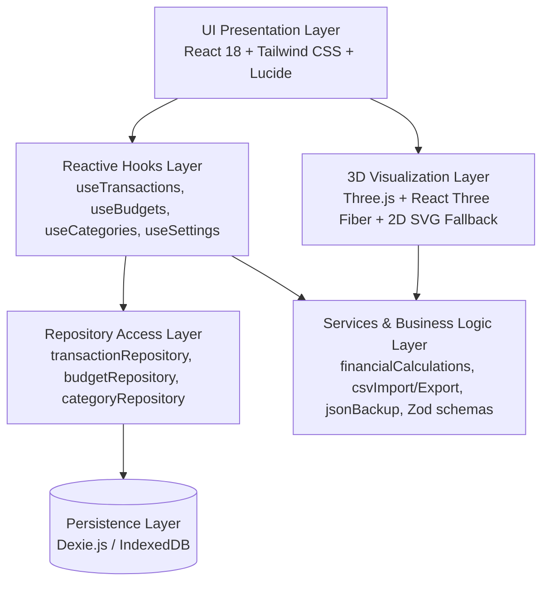
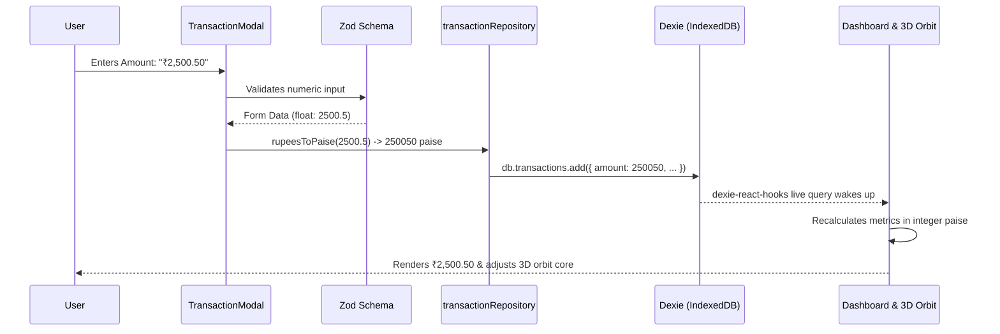

# System Architecture & Component Design

## 1. Architectural Style: Modular Layered Client-Only SPA

The application operates entirely within the user's browser without requiring a backend server. Its architecture is structured into clean, decoupled layers:

---

## 2. Directory & Layer Responsibilities

### 1. Presentation Layer (`src/features/`, `src/components/`)
- **`src/app/App.tsx`**: Top-level root component. Manages active tab routing (`dashboard`, `transactions`, `budgets`, `reports`, `categories`, `settings`), global modals, and database initialization.
- **`src/components/navigation/`**:
  - `Sidebar.tsx`: Collapsible desktop navigation bar with quick stats and academic badge.
  - `Header.tsx`: Sticky top header with quick action triggers and mobile drawer toggle.
  - `MobileNav.tsx`: Responsive drawer navigation for screens `< 1024px`.
  - `AcademicModal.tsx`: Displays BCA-308 project metadata, university credentials, student info, and guide.
- **`src/components/ui/`**: Reusable design primitives (`Button`, `Card`, `Badge`, `Input`, `Select`, `Modal`, `ConfirmDialog`, `ToastContainer`).
- **`src/components/forms/`**: Zod-validated modal forms (`TransactionModal`, `BudgetModal`, `CategoryModal`).
- **`src/components/charts/`**: Specialized Recharts analytics widgets.

### 2. Visualization Layer (`src/three/`)
- **`FinancialOrbitScene.tsx`**: R3F Canvas host with ambient lighting, point lighting, OrbitControls, and auto-rotation.
- **`CentralCore.tsx`**: Central pulsating sphere geometry whose size, emission glow, and color reflect net capital (green for positive savings, red/orange for negative).
- **`OrbitRings.tsx`**: Concentric geometric orbital lines giving a planetary structure.
- **`CategoryNodes.tsx`**: Orbiting celestial spheres representing expense categories, sized proportionally to spending amount, displaying tooltips on hover.
- **`Particles.tsx`**: Ambient drifting starfield particles.
- **`Orbit2DFallback.tsx`**: Accessible SVG concentric orbit rendering when WebGL is absent or motion is disabled.

### 3. Business Logic & Calculation Engine (`src/services/`)
- **`calculations/financialCalculations.ts`**:
  - Calculates Total Income, Total Expenses, Net Balance, Savings Rate.
  - Generates category breakdown with percentage shares.
  - Formulates daily spending velocity and monthly trend summaries.
  - Computes budget consumption percentage and warning threshold states.
- **`export/`**:
  - `csvExport.ts`: Formats transactions to CSV and sanitizes formulas (`sanitizeCsvCell`).
  - `jsonBackup.ts`: Exports complete IndexedDB dump (transactions, categories, budgets, settings).
- **`import/`**:
  - `csvImport.ts`: Parses CSV files, validates row schema, skips duplicate transaction IDs.
  - `jsonRestore.ts`: Verifies backup JSON schema and restores database state atomically.
- **`validation/schemas.ts`**: Zod schemas for forms, CSV rows, and backup JSON objects.

### 4. Data Access & Persistence Layer (`src/database/`)
- **`db.ts`**: Instantiates `Dexie` database with indexed schema:
  - `transactions`: `id, type, amount, category, date, createdAt`
  - `categories`: `id, name, type, isCustom, createdAt`
  - `budgets`: `id, category, month, createdAt`
  - `settings`: `key`
- **`seed.ts`**: Populates default categories and academic Table 7.3 test data.
- **`repositories/`**: Clean asynchronous repository functions decoupling components from raw Dexie table methods.

---

## 3. Data Flow & Precision Model

